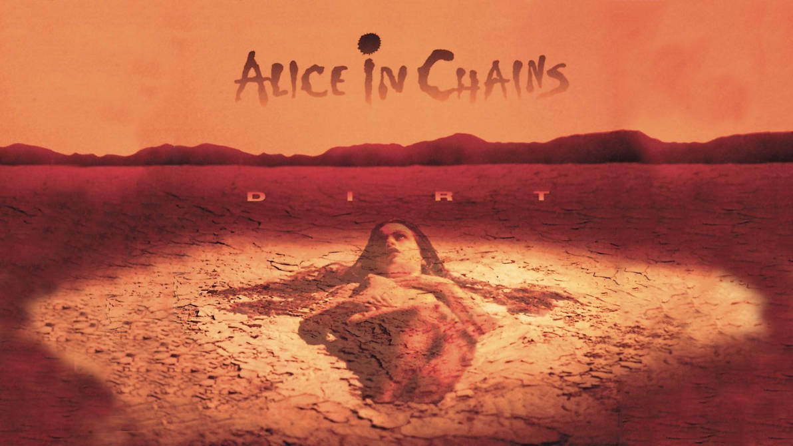

<div align="center">

<p align="center">
  
</p>

# 🩸 DIRT QUIZ

### Quanto você conhece o Alice in Chains?

*Um quiz interativo de rock com visual inspirado no álbum **DIRT** (1992), dashboard com Chart.js e dados de um sensor Arduino.*


</div>

---

## 🎸 Sobre o projeto

O **Dirt Quiz** é um projeto individual de tema livre, desenvolvido na **SPTech**. A proposta é unir duas paixões, **programação** e **rock**, em uma aplicação web com:

- um **quiz** de 8 perguntas sobre a história, os álbuns e os músicos do Alice in Chains;
- um **dashboard** que mostra o seu desempenho em gráficos;
- a integração com a API **[Dat-Acqu-Ino](https://github.com/BandTec/dat-acqu-ino)**, que traz leituras de um sensor Arduino para o dashboard.

O visual segue a capa do álbum *DIRT*: degradê de vinho para vermelho, texto branco, linhas finas e a capa inclinada na página inicial.

## ✨ Funcionalidades

| Página | O que faz |
|---|---|
| **Home** | Apresenta o projeto, tem o botão para começar o quiz e a seção "Sobre mim" em formato de tracklist. |
| **Quiz** | 8 perguntas de múltipla escolha, barra de progresso e feedback visual de acerto (verde) e erro (vinho). |
| **Dashboard** | Cartões com acertos, erros, aproveitamento e melhor placar, mais três gráficos em Chart.js. |

### 📊 Gráficos do dashboard

1. **Último placar:** gráfico de rosca com acertos e erros.
2. **Sua evolução:** gráfico de barras com as 8 últimas tentativas.
3. **Sensor Arduino:** gráfico de linha com as leituras da API Dat-Acqu-Ino. Se a API estiver offline, o gráfico usa dados simulados e avisa isso na tela.

## 🛠️ Tecnologias

- **HTML5** e **CSS3** (classes e flexbox)
- **JavaScript** puro
- **[Chart.js](https://www.chartjs.org/)** 4.4.1, para os gráficos
- **API Dat-Acqu-Ino**, para os dados do Arduino
- **Node.js + Express**, para servir os arquivos (opcional por enquanto)
- **MySQL**, com a estrutura já preparada e ainda desativada (veja o *Roadmap*)

## 📁 Estrutura de pastas

```
quiz-dirt/
├── app.js                    # servidor Express
├── package.json
├── .env.dev                  # configurações (porta e banco)
├── public/
│   ├── index.html            # Home
│   ├── quiz.html
│   ├── dashboard.html
│   ├── css/style.css
│   ├── js/
│   │   ├── quiz.js           # lógica do quiz
│   │   └── dashboard.js      # gráficos e API
│   └── assets/
│       ├── capa.png          # capa do álbum DIRT
│       └── perfil.png        # foto de perfil
└── src/                      # backend de login e banco (desativado por enquanto)
    ├── database/
    ├── models/
    ├── controllers/
    └── routes/
```

## 🚀 Como executar

### Jeito rápido

Abra o arquivo `public/index.html` no navegador. Não precisa de terminal nem de banco.

### Com o servidor Node

```bash
npm install
npm start
```

Depois acesse **http://localhost:3333**.

### Ligando a API Dat-Acqu-Ino

1. Clone e rode o [Dat-Acqu-Ino](https://github.com/BandTec/dat-acqu-ino) com o Arduino conectado. Por padrão, ele sobe em `http://localhost:3300`.
2. Abra `public/js/dashboard.js` e ajuste a variável `API_URL` com a rota correta da sua API.
3. Abra o dashboard. A legenda abaixo do gráfico avisa se os dados são reais ou simulados.

## 📏 Regras de código seguidas

Este projeto respeita as restrições da disciplina:

- ✅ Lógica básica, apenas com `if`, `else if`, `else`, `while` e `for`
- ✅ Apenas `let`, sem `var`
- ✅ Sem `document.getElementById`: os elementos são acessados pelo `id` (por exemplo, `div_exibir.innerHTML`)
- ✅ Apenas igualdade ampla (`==` e `!=`)
- ✅ CSS simples, com classes e flexbox, sem frameworks

## 🗺️ Roadmap

- [x] Quiz interativo
- [x] Dashboard com Chart.js
- [x] Integração com a API Dat-Acqu-Ino
- [x] Página inicial baseada no layout do projeto
- [ ] Tela de **cadastro e login**
- [ ] Salvar os placares no **banco de dados** (o código de apoio já está na pasta `src/`)
- [ ] Mais perguntas e níveis de dificuldade

## 👤 Sobre mim

**SEU NOME**, dev em formação, em São Paulo.

| Ano | Marco |
|---|---|
| **2020** | Mexi com software no Windows pela primeira vez e me apaixonei por programação. |
| **2023** | Entrei na Etec, no curso de Informática para Internet (ETIM). |
| **2024** | Mudei para São Paulo e entrei na Etec de Cidade Tiradentes, no mesmo curso, na modalidade MTec. |
| **Jul 2026** | Entrei na SPTech. |

## 🙏 Créditos

- Banda e álbum **DIRT**, de **Alice in Chains**. A capa e o nome pertencem aos seus respectivos detentores, e o uso neste projeto é apenas educacional.
- API **Dat-Acqu-Ino**, da [BandTec](https://github.com/BandTec/dat-acqu-ino).
- Estrutura de pastas inspirada no [web-data-viz](https://github.com/BandTec/web-data-viz).

<div align="center">

*Feito com código, café e muito grunge.* 🖤

</div>
