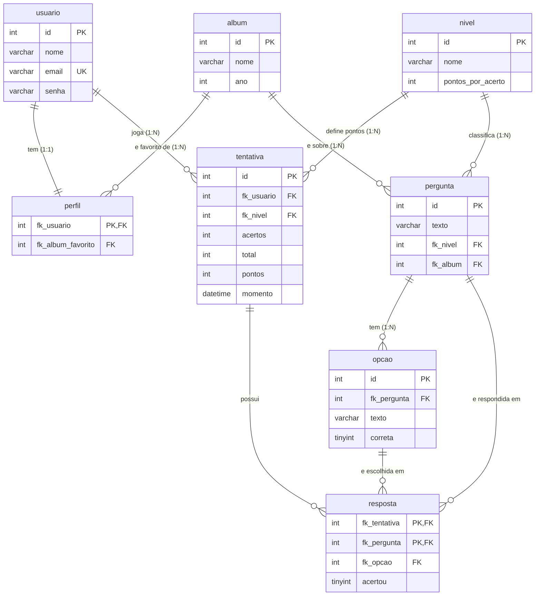

# Alice in Chains · Quiz

Projeto individual (SPTech): quiz sobre as músicas de **Facelift**, **Dirt** e **Jar of Flies**, com cadastro, login, ranking e dashboard em Chart.js.
Feito em cima do projeto base **web-data-viz** (Node.js + Express + MySQL), mantendo a estrutura de rotas, controllers e models.

## Telas

| Tela | Arquivo | O que faz |
|---|---|---|
| Home | `public/index.html` | Explica o site, mostra os 3 álbuns (clicar muda o tema do site) e tem o "Sobre mim". |
| Cadastro | `public/cadastro.html` | Cria a conta com validação de nome, e-mail e senha segura. |
| Login | `public/login.html` | Entra no site. |
| Toca-discos | `public/toca-discos.html` | Um disco de vinil que acende e gira ao escolher um álbum, tocando uma música dele. |
| Carteirinha | `public/dashboard/carteirinha.html` | Carteirinha de fã com o nome, o álbum favorito e o nível de fã, calculado pelos pontos do quiz. |
| Quiz | `public/dashboard/quiz.html` | 3 níveis (fácil, médio, difícil) com 8 perguntas cada, vindas do banco. |
| Dashboard | `public/dashboard/dashboard.html` | KPIs e gráficos calculados no MySQL. |

## Modelagem lógica

O banco `quiz_aic` tem 8 tabelas.



| Tipo | Relacionamento | Como foi feito |
|---|---|---|
| **1:1** | `usuario` e `perfil` | `perfil.fk_usuario` é ao mesmo tempo chave primária e estrangeira. |
| **1:N** | `usuario` e `tentativa` (e também `album`/`pergunta`, `nivel`/`pergunta`, `pergunta`/`opcao`) | A chave estrangeira fica no lado "N". |
| **N:N** | `tentativa` e `pergunta` | Uma partida responde várias perguntas, e uma pergunta aparece em várias partidas. A tabela associativa é `resposta`, com chave primária composta (`fk_tentativa`, `fk_pergunta`). |

## Como rodar

1. No MySQL (na VM), execute `src/database/script-tabelas.sql`. Ele recria o banco `quiz_aic` do zero, com as perguntas.
2. Copie `.env.dev.example` para `.env.dev` e preencha com os dados do seu banco.
3. Rode:
   ```bash
   npm install
   npm start
   ```
4. Abra `http://localhost:3333`.

## Estrutura

```
app.js                      servidor Express
src/
  database/                 config.js (conexão) e script-tabelas.sql
  routes/                   usuarios.js e quiz.js
  controllers/              validam o que chega e respondem
  models/                   guardam os comandos SQL
public/
  index.html, login.html, cadastro.html
  dashboard/                quiz.html e dashboard.html
  css/estilo.css            um único CSS, com os temas por álbum
  js/                       um arquivo JS por tela, mais validacao.js, sessao.js e tema.js
```

Mais detalhes sobre o código estão em `ALTERACOES.md`, e o registro de uso de IA está em `DIARIO_DE_PROMPTS.md`.
